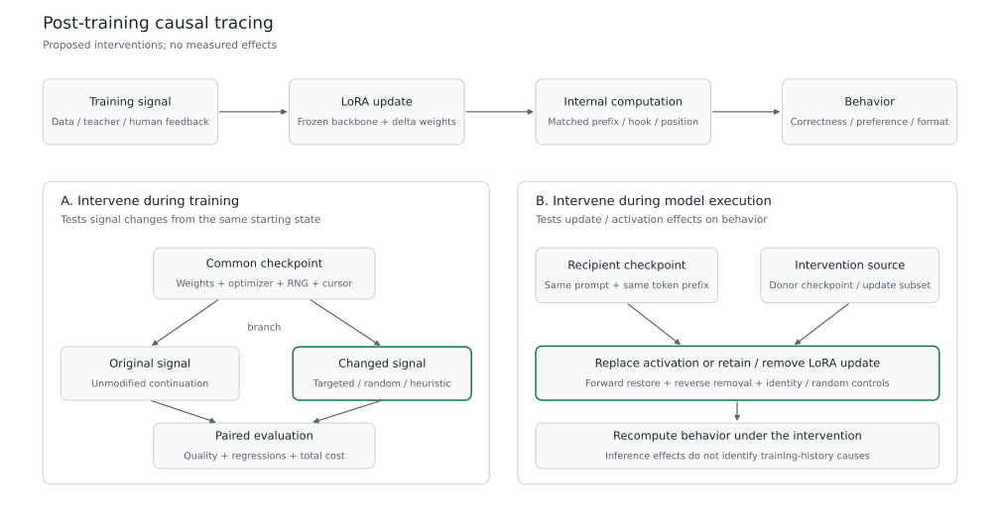

# 大模型后训练的因果追踪：文献调研与实验设计

调研与修订日期：2026-10-27。项目名：PostTrain Causal Lab。

早期执行路线按2～4张H20分步验证。首轮2-H20 A0已通过执行一致性门禁，见 [实测记录](experiments/a0-20261027-110309/REPORT.md)。本轮直接扩大到24卡，采用3配对seed × SFT／KD／OPD-32／OPD-256矩阵，沿用Qwen3.5-4B／9B；[冻结协议](experiments/scale24-20261027/PROTOCOL.md) 已提交排队，尚无该轮质量或干预结果。更大参数模型的候选与进入条件仍见“从小实验到定向大实验”。

本文主体记录公开文献与拟议实验，论文结果属于原作者报告。本项目已完成真实模型上的短程更新、GDN 干预与状态重放工程检查；这些结果不能代替质量、机制或规模验证。检索覆盖 LoRA、on-policy distillation、偏好优化、激活干预、训练数据归因及相关工具，包含截至调研日已公开的近期预印本，不构成穷尽性系统综述。

## 研究范围与问题

后训练改变了输出，但输出差异本身不能解释改变来自哪里。项目要追踪的是：某类训练样本或反馈，是否通过特定参数更新与内部计算，导致可测量的行为变化；改变该信号或计算后，变化能否消失、恢复或被修复。

LoRA、OPD、RLHF 不在同一个分类轴上。LoRA 限制可训练参数；OPD 在学生生成的前缀上提供教师监督；经典 RLHF 用人类偏好训练奖励模型，再通过强化学习优化策略。三者可以组合，例如 LoRA-SFT、LoRA-OPD 和 LoRA-PPO-RLHF。DPO 是直接利用偏好对的另一种优化方式，不能把 DPO 实验直接称为完成了 PPO-RLHF。<a href="#s1">[cite:1]</a><a href="#s2">[cite:2]</a><a href="#s3">[cite:3]</a><a href="#s4">[cite:4]</a>

本文按 OPD = **On-Policy Distillation，在线策略蒸馏**理解。这里的 on-policy 指训练前缀由当前学生策略产生，不要求系统使用异步在线服务。固定教师生成的数据上的监督微调属于离线蒸馏；教师给学生回答打分后做 PPO，和在学生前缀上拟合教师 token 分布，也应分别记录。<a href="#s2">[cite:2]</a><a href="#s13">[cite:13]</a>

研究问题按证据成本递进：

| 问题 | 能回答它的主要实验 | 结论边界 |
|---|---|---|
| 后训练行为变化由哪些更新和计算介导？ | 同底座 checkpoint 激活替换、adapter 移除与移植 | 能定位指定干预下的介导位置，不能仅凭热图断言知识存储位置 |
| OPD 改善了内容、格式，还是学生犯错后的继续生成？ | 离线 KD／OPD 对照、共同前缀评测、反馈掩码重训 | 需要独立正确性评测，教师 KL 降低不能代替质量提升 |
| 偏好优化学到了有用内容，还是长度与表达风格？ | 内容保持的呈现改写、奖励重评、内部干预、真实人类复核 | 原始偏好标签不一定在改写后保持有效 |
| 定位结果能否指导更好的后训练？ | 从相同训练状态分叉，对比定向修复与匹配随机干预 | 推理干预成功不自动证明训练收益 |

与 AI Infra 工作衔接的部分是实验执行器、训练状态分叉、模型与数据版本、批量干预、缓存和数值一致性。研究结论仍必须由质量与干预实验支持，吞吐提升不能代替机制证据。

## 因果追踪的三个层次

**计算干预**改变模型执行时的一个内部变量，例如替换某层残差、某个 attention 输出或一个 adapter 的输出。它直接测试指定计算是否影响行为。ROME、激活 patching 方法研究与相关工具提供了可复用基础。<a href="#s5">[cite:5]</a><a href="#s6">[cite:6]</a><a href="#s16">[cite:16]</a>

**参数干预**改变某个训练完成的模型，例如关闭一个 LoRA 模块，或只保留某个更新子空间。它测试参数变化对当前行为的作用。关闭 adapter 后行为消失，只说明适配器整体参与了变化；进一步的子集、随机匹配与恢复实验才有助于缩小解释范围。LoRA 的可移植更新使这一层容易实施。<a href="#s1">[cite:1]</a><a href="#s11">[cite:11]</a><a href="#s21">[cite:21]</a>

**训练干预**从同一训练状态出发，改变数据、反馈、损失或可训练子空间，再继续训练。它测试训练历史中的原因。训练数据 influence score、梯度相似度和激活差异可以筛选候选因素；它们不能替代删除、替换或重加权后的重训验证。DataInf 提供了适合 LoRA 的影响估计，但仍是近似归因。<a href="#s14">[cite:14]</a>

图 1：训练反馈到输出行为的路径是研究假设。右侧模型执行干预测试“参数／激活 → 行为”；从共同 checkpoint 分叉的重训测试“训练信号 → 后续模型”。两种证据不能相互替代。图中没有实验数据。

推理期 patching 给出的是人为设定内部变量后的效果。它不自动识别完整训练过程中的自然间接效应：训练轨迹存在反馈、参数与表示共同变化，干预后的激活也可能偏离受体模型的常见分布。结果应写成“在该任务、位置与干预协议下介导了变化”，而不是“找到了模型唯一的原因”。激活方法敏感性与定位不一定指导编辑的结果，均支持保留这一限定。<a href="#s6">[cite:6]</a><a href="#s7">[cite:7]</a>

## 文献中的已知结果

### 方法基础

| 工作 | 原文支持的内容 | 项目中的用途 |
|---|---|---|
| LoRA，2021／ICLR 2022 | 冻结底座，以低秩矩阵表示权重更新 | 控制训练范围，保存更新，按模块与子空间干预 <a href="#s1">[cite:1]</a> |
| GKD，ICLR 2024 | 在学生自产生序列上查询教师分布，可选择不同散度；原实验包含 T5 任务 | OPD 的首选复现定义；不直接搬用原论文收益到 Qwen <a href="#s2">[cite:2]</a> |
| InstructGPT，NeurIPS 2022 | 演示监督、偏好奖励模型与 PPO 构成 RLHF 流程 | 定义人类反馈分支，保存奖励模型来源 <a href="#s3">[cite:3]</a> |
| DPO，2023 | 用偏好对及 reference 相对概率直接优化，无需显式 RM 和在线采样循环 | 低成本偏好对照，单独标注为 DPO <a href="#s4">[cite:4]</a> |
| ROME，NeurIPS 2022 | 用激活恢复定位事实预测中的关键计算，再做权重编辑 | 理解 clean／corrupt／restore 的实验结构 <a href="#s5">[cite:5]</a> |
| Activation Patching Best Practices，ICLR 2024 | 指标与 corruption 方法会改变定位结果 | 主指标、对照与位置规则预先固定 <a href="#s6">[cite:6]</a> |
| Does Localization Inform Editing，NeurIPS 2023 | 因果定位分数并不可靠预测最佳事实编辑层 | 单独检验“定位能否指导训练”，保留随机与启发式 baseline <a href="#s7">[cite:7]</a> |

这些工作共同支持干预方法的可实施性，也说明定位结果受问题和方法影响。[CONFIRMED] 支持范围是“可以建立干预实验”，不包括“后训练普遍集中在中间层”或“定向微调必然更好”。

### 直接相关与近期工作

| 工作 | 原作者报告 | 证据限制与项目关系 |
|---|---|---|
| Alignment is Localized，2025-10-17 | 在 Llama-3.2-1B 的模型对上做层级跨模型 patching，报告局部和低维效果 | [SINGLE-SOURCE] 方法节使用公开 Base／Instruct 对及 80 个偏好对，没有本项目所需的已知训练分叉；不能将差异单独归于 DPO 或 PPO。可借鉴双向 patching、identity／random 与插值对照 <a href="#s8">[cite:8]</a> |
| The Anatomy of Alignment，2025-09-25，v2 | 训练 SAE 特征 steering adapter，以 SimPO 优化；报告风格特征对偏好目标有较强作用 | [SINGLE-SOURCE] 特殊 adapter／SAE 与 SimPO setting 的观察，不是普通 LoRA 或完整 PPO 的普遍机制。支持研究内容与呈现混淆 <a href="#s9">[cite:9]</a> |
| SafeEvo，2026-10-07 | 追踪安全回路跨 checkpoint 的变化，比较回路定向 SFT／DPO 与普通更新；报告回路存在非唯一性 | [SINGLE-SOURCE] 新预印本，主要是安全拒绝、7B／8B setting。时间追踪和回路定向训练已有直接先例 <a href="#s10">[cite:10]</a> |
| TopKLoRA，2026-10-23 | 在 LoRA bottleneck 加入 ReLU／TopK，研究后门行为的必要与充分子集 | [SINGLE-SOURCE] 新预印本，特殊稀疏 adapter 与后门 setting。普通 LoRA latent 不可唯一识别；“可解释 LoRA＋回路消融”不能作为全新方向 <a href="#s11">[cite:11]</a> |
| Gains and Collapse in OPD，2026-10-02 | 在 sampled-token reverse-KL 配方下研究采样效率与重复退化，并报告掩码和 SFT 初始化缓解退化 | [SINGLE-SOURCE] 新预印本，实验使用特定数学任务与配方。“没有扩展学生能力”受有限采样审计限制，不能推广到全部 OPD。支持把教师反馈质量与教师自产生回答质量分开 <a href="#s12">[cite:12]</a> |
| OPD Survey，2026-04-01 | 整理反馈信号、教师访问方式和监督粒度 | 分类与检索入口；综述中的性能和理论主张仍应回到原论文核验 <a href="#s13">[cite:13]</a> |

对 Alignment is Localized 的方法检查尤其重要：其标题和讨论涉及偏好优化，但公开 Base／Instruct 终点比较不能隔离具体训练算法。第一版应自行产生同底座训练轨迹，明确 reference、adapter 与训练数据，而不是仅下载两个不同发布 checkpoint 就宣称揭示 RLHF 机制。<a href="#s8">[cite:8]</a>

OPD 退化论文分析的是带特定梯度估计、clipping 和 reference regularization 的 reverse-KL 实现。GKD 在固定采样前缀上直接优化 full-vocabulary 散度，两者存在联系，但不能把 sampled-token 策略梯度公式当作所有 GKD 的完整梯度。<a href="#s2">[cite:2]</a><a href="#s12">[cite:12]</a>

### 反例与尚未确立的结论

“中间层最重要”不是预设答案。ROME 的事实召回、某个小模型的偏好 margin 与安全回路是在不同 setting 下测量的不同对象；定位与最佳编辑层之间还存在明确反例。项目应让搜索覆盖实际可干预的层与模块，不能先选中间层再用实验证明它。<a href="#s5">[cite:5]</a><a href="#s7">[cite:7]</a><a href="#s8">[cite:8]</a>

“奖励变高说明质量变好”也不成立。奖励模型可能共享错误，多个奖励模型之间还可能在优化后产生不同评判；近期 OPD 工作也报告教师反馈偏好与生成质量背离。评价至少保留独立正确性或人类复核。<a href="#s9">[cite:9]</a><a href="#s12">[cite:12]</a><a href="#s15">[cite:15]</a>

目前证据不足以预先回答：OPD 与 PPO 是否改变同一批回路；定向限制更新是否降低遗忘；小模型找到的介导子空间是否迁移到大模型。以上均为待检验假设，不能列作项目已有结论。

## 与已有工作的关系

本轮资料显示，激活追踪、LoRA 消融、跨 checkpoint 回路演化与定位引导训练均已有先例。项目的候选贡献是把这些能力组合成一个可审计实验闭环，并验证其解释能否经受训练干预。

| 已有能力 | 本项目拟增加的证据 | 怎样避免重复性展示 |
|---|---|---|
| 终点模型 patching | 同底座、已知训练历史的时间轨迹 | 保存反馈与 optimizer 状态，定位变化出现前后的可重训分叉 |
| adapter／回路消融 | 模块与更新子空间的必要性、充分性、随机匹配 | 不把单次移除成功当作完整机制 |
| OPD 分数与退化分析 | 反馈候选 → 参数更新 → 内部介导 → 重训修复 | 将诊断方法与 loss／长度启发式比较 |
| 回路引导微调 | 定向修复在质量、遗忘和总成本上的结果 | 与同规模、同更新强度的随机限制对照 |

这是一项合理的工程与研究选题。[INSUFFICIENT DATA] 本轮检索不能证明组合方案具有学术首创性。若后续准备投稿，还需围绕最终贡献细化相近工作检索，并独立复现最接近的 baseline。

## 第一版实验

### 模型与数据

首轮学生使用 **Qwen3.5-4B**，教师使用 **Qwen3.5-9B**。两者官方语言模型配置都是 32 层，以每三层 Gated DeltaNet 加一层 Gated Attention 的方式混合，分别采用隐藏维度 2560 与 4096。它们是 dense FFN 的混合注意力模型，不应根据整系列的 MoE 宣传将 4B／9B 标注成 MoE。首轮固定这一模型对比较训练目标；后续在 Qwen3.8 与 Qwen3.6 上检验筛出的机制。<a href="#s24">[cite:24]</a><a href="#s25">[cite:25]</a>

| 角色与阶段 | 精确模型名称 | 架构与语言模型规模 | 选型目的 |
|---|---|---|---|
| 首轮学生 | Qwen/Qwen3.5-4B | 4B，32 层，GDN／Gated Attention＋dense FFN | 每组 2 卡的 SFT／离线 KD／OPD 对照 <a href="#s24">[cite:24]</a> |
| 首轮教师 | Qwen/Qwen3.5-9B | 9B，32 层，同类混合架构 | 固定同代教师，减少配方比较中的额外变化 <a href="#s25">[cite:25]</a> |
| 新版本验证 | Qwen/Qwen3.8-27B | 27B，64 层，沿用 Qwen3.5 架构基础，dense FFN | 每组 4 卡，只重跑筛出的一个对照与干预 <a href="#s29">[cite:29]</a> |
| 小型 MoE 验证 | Qwen/Qwen3.6-35B-A3B | 总参数 35B／激活 3B，40 层，256 个 routed experts，8 routed＋1 shared 激活 | 每组 4 卡，检验路由与专家是否改变机制 <a href="#s30">[cite:30]</a> |
| 百 B 级中间台阶 | Qwen/Qwen3.5-122B-A10B | 总参数 122B／激活 10B，48 层，混合注意力 MoE | 小实验通过后，优先考虑的较新代际大型 MoE <a href="#s31">[cite:31]</a> |
| 235B 对应型号 | Qwen/Qwen3-235B-A22B | 总参数 235B／激活 22B，94 层，标准 attention MoE | 用户所述规模的明确候选；属于 Qwen3，不伪称 3.5／3.6／3.8 <a href="#s32">[cite:32]</a> |
| 更新代际的超大候选 | Qwen/Qwen3.5-397B-A17B | 总参数 397B／激活 17B，60 层，混合注意力 MoE | 需要百 B 以上验证且容量检查通过时的候选 <a href="#s33">[cite:33]</a> |

表中规模来自官方模型卡，不是本地参数重计数或容量实测。模型全部采用精确仓库名称，不添加未经核实的 `-Instruct` 后缀。Qwen3.8-27B 与 Qwen3.5 的架构有继承关系，版本与训练历史的变化不能自动当作完全独立的架构复现。

用户提到的“235B23A”对应的已核实官方名称是 **Qwen3-235B-A22B**。本轮没有核实到 Qwen3.5／3.6／3.8 中精确名为 65B 的开放权重模型；“约 65B dense”保留为容量档位，具体仓库确定后才纳入实验。优先使用已核实的较新代际候选，235B 型号作为明确标注版本的大规模补充。<a href="#s32">[cite:32]</a>

教师与学生只在输出分布上连接。大小不同的教师隐藏状态不能直接移入学生；跨 checkpoint 激活替换仅在学生自身的同架构训练轨迹间进行。4B、9B、27B 的模型卡均列出 padded 输出词表 248320，但相同维度不足以证明 token 对齐：启动时核对完整 token→ID 映射、特殊 token、词表输出维度与实际渲染模板。当前 GKD 源码只做 vocab_size 检查，仍需补充这一门禁。<a href="#s24">[cite:24]</a><a href="#s25">[cite:25]</a><a href="#s29">[cite:29]</a><a href="#s28">[cite:28]</a>

所有 student 分支从相同 $\theta_0$ 出发，保持相同 LoRA attachment sites、初始化、rank、precision 和优化器。拟议初始 rank 为 16，先适配 Gated Attention 输出投影、GDN 输出投影及 dense FFN down 投影；模块路径通过实际模型结构枚举后冻结，不套用 Qwen2.5 的 q／v attachment 假设。首轮冻结视觉编码器、embedding、lm_head 和 MTP；这是文本后训练范围，实际加载容量仍包含完整 checkpoint 的相关开销。

Qwen3.5／3.8 默认支持 thinking，Qwen3.8 还提供 reasoning effort 等控制。执行一致性 pilot 先用固定 non-thinking 短输出协议；正式数学能力分支单独冻结 thinking 模式与输出预算，不将两种模式混在同一质量比较中。短输出通过只说明该协议可运行，不能替代长推理质量验证。<a href="#s24">[cite:24]</a><a href="#s29">[cite:29]</a>

先建立两个各自有效的实验系列：

| 系列 | 数据与目标 | 分支 | 主要用途 |
|---|---|---|---|
| A：蒸馏与能力 | GSM8K 官方训练题；固定答案格式，内容正确性与格式分别评分 | 无增量训练、SFT、固定前缀 KD、OPD | 验证追踪工具，研究学生前缀监督与能力／格式变化 <a href="#s27">[cite:27]</a> |
| B：人类偏好 | HH-RLHF 的 helpfulness 子集，固定来源 tranche，保留真实 chosen／rejected | 相同初始模型、DPO、RM＋PPO；之后再增加已知来源教师的 OPD | 研究呈现偏差和真实人类反馈下的变化 <a href="#s26">[cite:26]</a> |

系列 A 的主要行为指标是最终答案正确率；格式遵循、输出长度和重复是辅助指标。“内容改善”与“格式更容易被 parser 接受”分别计算，避免解析成功率变化被误判为数学能力变化。系列 B 的主要指标是独立人类偏好评价；训练 RM score 作为诊断指标。

GSM8K 的公开测试题只用于最终评测；开发、归因搜索、修复选择使用训练划分中事先留出的题目。公共 benchmark 可能进入模型预训练，因此成绩只表示该公开评测协议下的变化，不能证明完全无污染的新增能力。数据解析、数字归一化与最终答案提取规则必须固定，格式失败和数字错误分别记录。

HH 数据是相对偏好数据，不应把所有 chosen 当成高质量 SFT 标准答案。它的 helpfulness 包含 base、rejection-sampling 与 online 等不同来源；第一版固定一个来源，正确提取共同对话历史和最后一个 assistant completion。内容保持的风格改写用于额外评测时，必须复核语义和偏好有效性，不能继承原标签。<a href="#s26">[cite:26]</a>

在系列 A 中，SFT／KD／OPD 的反馈信息不同，比较的是完整训练配方。用于隔离 **prefix 分布**的对照保持教师、散度和损失归一化相同，仅改变固定数据前缀与学生前缀；用于隔离散度的对照在共同前缀池上进行，随后再评估各自重新采样的完整训练过程。两个系列的结果分别报告。

系列 B 中，DPO 与 PPO 可使用相同人类偏好训练集，但 PPO 还包含 RM 拟合与策略采样，差异仍包括这些环节。若之后加入 OPD，需要记录教师从哪些数据和训练算法得到；普通公开 Instruct 教师的蒸馏，不能用来单独证明“人类反馈产生了该机制”。

### 递进实验与进入条件

“每组 2～4 卡”指一个实验条件、一个 seed 的完整 GPU 分配，包含 learner、teacher、reference、RM 与 critic 的实际 GPU 使用；不是每个角色各自再加 2～4 卡。CPU 判分和存储另计。先完成一个组的工程 pilot，再逐组开展配方对照，避免同时冷启动多份教师权重。

| 阶段 | 每组 H20 | 模型与工作 | 进入下一阶段的条件 |
|---|---|---|---|
| A0：执行一致性 | 2 | Qwen3.5-4B／9B：加载、一次完整更新、GDN 输出干预、保存与恢复 | identity／恢复与梯度门禁通过，产物完整 |
| A1：受控训练 | 2 | Qwen3.5-4B 学生：SFT、固定前缀 KD、OPD；教师固定 Qwen3.5-9B | 两个配对 seed 上出现可复核的变化，保留质量、长度、格式和 KL |
| A2：模型干预 | 2 | 对 A1 的学生 checkpoint 做层类型／模块粗定位，验证必要性与充分性 | 未参与搜索的验证题上保留效果，超出匹配随机扰动 |
| A3：训练干预 | 2～4 | 相同状态分叉：原配方、定向修复、匹配随机与启发式 | 独立质量、回归和总成本证据完整 |
| B1：真实偏好 | DPO 2；PPO 4 | Qwen3.5-4B，真实 HH 偏好；PPO 组内安排 RM／reference／value | 奖励模型独立检查与人类复核协议冻结 |
| V1：新版本验证 | 4 | Qwen3.8-27B：只重跑筛出的一个配方对照和干预 | 机制预测的方向在新版本成立；单独报告效应大小 |
| V2：小型 MoE 验证 | 4 | Qwen3.6-35B-A3B：只验证相关输出子空间与路由变化 | router／expert mapping 与数值门禁通过 |

A0 使用一张卡运行 FP32 student，另一张卡运行冻结的 BF16 teacher，先建立单 learner 的更新、GDN 干预与状态恢复证据。两张已分配卡的完整执行时间均计入成本，包括 SFT 时空闲的 teacher 卡。A0 的短程 SFT／KD／OPD 各运行四步，不作为 A1 的质量或 DDP 性能结果。

A1 的 2 卡方案仍候选使用 DDP learner：每张卡加载同底座 student 和冻结的 9B teacher 副本，teacher 仅在 KD／OPD 条件执行评分。SFT 条件使用相同两卡 learner、optimizer 与有效 token 归一化。该同卡容量与跨 rank 归一化尚未验证；若不通过，改为 4 卡、2 learner＋2 teacher，以相同布局重跑离线 KD 与 OPD。

student 与 teacher 的 precision 分别冻结。先校验 FP32 参考路径，再决定 BF16 student 是否通过 logits、loss 与 adapter 梯度门禁；通过后的所有主对照使用同一 student precision。若采用 FP32 student，其语言权重容量按 BF16 表的两倍计入；更换 GDN 后端或降低 precision 需重新检查，不能只依据模型名称兼容。

4 卡的 27B／35B 验证优先使用已校验的 FSDP／适用的并行后端分片；是否能同时容纳 teacher 与训练状态由实测决定。纯 inference tensor parallel 不能当作训练分片支持。新版本检查按一个已选问题展开，不做所有模型×所有目标的笛卡尔积。

探索先使用两个配对训练 seed；只有决定性的对照增加第三个独立 seed。最终机制主张仍要求至少三个 seed 与独立干预验证。初步两个 seed 的方向一致可以指导后续实验，不能写成广泛算法优越性。

数据已冻结为 256 道训练题、64 道开发题、64 道干预验证题，均从 GSM8K 官方 train 的固定版本镜像中按题目去重、seed 洗牌后划分，清单与 SHA256 见 [`code` 分支的 data/manifest.json](https://github.com/Cheongroach/posttrain-causal-lab/blob/code/posttrain_causal_lab/data/manifest.json)。A0 包只携带训练题；官方 test 保留给最终评测。A1 才做同有效 token 预算的配方对照，通过后再增加到约千题规模。

工程 pilot 采用 2 卡、启动后 1 小时的初始窗口；三个行为条件各自先使用 2 卡、启动后不超过 2 小时，分开提交配对 seed。超时产物属于诊断，不冒充完整质量结果；后续窗口根据首轮有效吞吐重定，排队时间与真实执行时限分开。这些窗口是阶段投入边界；A0 的实际资源区间与成本另见实测记录。

拒绝行为、迎合、遗忘和长推理退化都可作为后续任务。第一版只选择一个主要行为；只有短输出 pilot 通过后才扩展长序列，避免将截断伪装成推理质量下降。

### 从小实验到定向大实验

大实验只检验小实验已形成的一个机制预测。例如“学生错误前缀上的教师反馈导致某类输出更新，并推动重复退化”，或者“定向限制某个输出子空间可以保留质量同时降低副作用”。先冻结方向、干预位置定义、主要指标、配方和随机对照，再选择最能区分解释的大模型。

| 小实验观察 | 定向扩大方式 | 大实验对照 |
|---|---|---|
| 定向反馈干预优于随机／启发式，且质量副作用可控 | 先升级 Qwen3.8-27B；若效果成立，再选约 65B dense 档或 122B-A10B | 原配方、定向修复、同规模随机修复；不重做全部 loss 搜索 |
| 效果依赖 GDN 与 Gated Attention 的不同输出位置 | 优先选同类混合架构的 Qwen3.5-122B-A10B | 按层类型、相对深度与 token role 迁移定义，重新验证位置 |
| 效果与 MoE 路由／专家更新相关 | 小型 Qwen3.6-35B-A3B 通过后，再选 122B-A10B 或 397B-A17B | router／expert 干预、公共输出子空间干预与匹配随机 |
| 需要检验标准 attention MoE 的机制边界 | 使用 Qwen3-235B-A22B，明确记录它与混合架构的差别 | 检验预先定义的机制是否跨架构成立，不作为新版性能排名 |

升级条件是：终态训练和干预产物完整；决定性对照的三个 seed 可复核；冻结验证集上的干预方向和副作用支持同一解释；定向修复与匹配随机对照可以区分；恢复、词表／模板和后端梯度检查通过。只看到 loss 下降、任务成功退出或一张漂亮热图，不触发大模型实验。

大型阶段先选择一个目标模型；先短程 LoRA 与稀疏干预验证，再延长训练。首选 122B-A10B 作为较新代际的百 B 台阶，是否继续到 235B／397B 由它是否回答剩余问题决定。大模型自身只加载并打分属于“大教师实验”，只有该模型实际更新并通过行为与干预验证，才属于“大模型后训练实验”。

约 65B dense、235B-A22B 与更大的 MoE 均不沿用小实验的 2～4 卡容量假设。按模型权重、激活、adapter／optimizer、teacher 与实际并行方式计算卡数；容量预验通过后再固定完整 GPU·h 预算。大实验在小实验门禁通过之后进入，不因型号已经列入表就自动启动。

## 干预与测量协议

### 固定前缀上的激活替换

定义 $\theta_a,\theta_b$ 为同底座学生的两个 checkpoint；$x$ 为相同 prompt，$y_{<t}$ 为相同固定前缀。$h_{\ell,p}^{a}$ 和 $h_{\ell,p}^{b}$ 分别是指定层 $\ell$、token 位置 $p$ 和指定 hook site 上的激活。

受体模型执行 $\theta_a$，在该位置做：

$$
h_{\ell,p}^{\mathrm{patch}}
=h_{\ell,p}^{a}+\gamma\left(h_{\ell,p}^{b}-h_{\ell,p}^{a}\right),
\qquad \gamma\in[0,1].
$$

其余计算由受体继续完成。固定 token IDs、attention mask、position IDs、completion mask 和 hook 的输入／输出语义。自由生成产生的不同 token 序列不能按相同绝对下标直接替换；固定前缀的条件预测与重新生成完整答案的行为变化分开报告。

对于冻结的偏好对，主要连续分数可定义为：

$$
M(\theta;x,y^+,y^-)
=\log p_\theta(y^+\mid x)-\log p_\theta(y^-\mid x).
$$

只对 completion 求和，单位为 nats。另报告按各自 completion token 数归一化后的 margin；它是不同指标，不替换训练中原始 DPO 目标。对最终数字、JSON 格式等目标，使用各自独立的判分函数，不能统一简化成一个偏好分数。

在同一组验证样本上报告：

$$
\Delta_{\mathrm{train}}
=\mathbb{E}\!\left[M(\theta_b)-M(\theta_a)\right],
\qquad
\Delta_{\ell,p}^{\mathrm{patch}}
=\mathbb{E}\!\left[M(\theta_{a\leftarrow b,\ell,p})-M(\theta_a)\right].
$$

主报告使用有符号差值及置信区间。只有总训练差异稳定远离零时，才辅助给出恢复比 $\Delta_{\ell,p}^{\mathrm{patch}}/\Delta_{\mathrm{train}}$；比值可以为负或超过 1，不截断成“贡献百分比”，也不能将各层比值相加。

整层残差包含上游计算。某层替换恢复了行为，并不证明改变起源于该层。粗定位后应测试 attention／MLP 输出、局部 adapter 更新和必要的路径干预，逐步检查上游传递与本地更新的区别。<a href="#s5">[cite:5]</a><a href="#s6">[cite:6]</a>

在 Qwen3.5／3.6／3.8 上，hook registry 同时记录 GDN、Gated Attention 和 dense FFN／MoE 层类型。首轮优先替换残差与模块输出，按相同完整前缀重新执行，不直接覆盖形状相近但语义不同的 attention／GDN 内部状态。

GDN 的 recurrent state、卷积缓存、token position 和 chunk 边界共同定义继续生成状态。若后续在 cached decode 中干预 state，必须同时定义 donor／recipient 状态版本、同前缀长度和缓存有效范围；只替换 hidden vector 后继续使用未配套的旧 cache，不能作为有效因果实验。模型卡确认的混合架构决定了这一扩展需要单独验证。<a href="#s24">[cite:24]</a><a href="#s29">[cite:29]</a>

MoE 分支还需记录 routed expert IDs、router 分布和 shared expert 路径。跨并行 rank 的干预先重建逻辑张量与 expert mapping，不把 local shard index 当作全局专家编号。路由变化可作为候选解释；它与行为相关仍需单独干预确认。

必须包含以下对照：

| 对照 | 排除的解释 |
|---|---|
| Identity patch、空 hook | hook 实现或数值路径本身改变输出 |
| 正向恢复与反向移除 | 只有一个移植方向出现异常 |
| 插值强度扫描 | 只在极端、离分布状态下出现效果 |
| norm 匹配的随机／打乱 donor | 任意同尺度扰动都能产生类似效果 |
| 相同大小随机位置集合 | 大范围扰动造成的一般退化 |
| 无关任务与同长度样本 | 目标效果实际来自语言能力损坏或长度偏置 |
| 归因搜索／验证分离 | 在同一批题上搜索后再次证明自己 |

不得将所有观察性热图称为 causal tracing。只有包含实际干预和受体重算的结果才属于该协议；probe、CKA、attention 可视化和梯度排序是辅助分析。

### LoRA 模块与更新子空间

对线性层，定义：

$$
W_\ell^{(s)}=W_\ell^{(0)}+\Delta W_\ell^{(s)},
\qquad
\Delta W_\ell^{(s)}=\frac{\alpha_{\mathrm{LoRA}}}{r}B_\ell^{(s)}A_\ell^{(s)}.
$$

$W$ 布局为 $[d_{\mathrm{out}},d_{\mathrm{in}}]$，$B$ 为 $[d_{\mathrm{out}},r]$，$A$ 为 $[r,d_{\mathrm{in}}]$。推理关闭 dropout 后，模块干预可以是 $\Delta W_\ell\mapsto\gamma_\ell\Delta W_\ell$。训练模式中的 dropout 与其他 LoRA 变体必须另行定义，不能套用相同等价性。<a href="#s1">[cite:1]</a><a href="#s21">[cite:21]</a>

普通 LoRA 的原始 latent 编号没有唯一语义。对任意可逆 $R$，$BA=(BR^{-1})(RA)$；同一函数可由不同 latent 坐标表示。因此不能直接把“第 7 个 LoRA 维度”命名为某个概念并跨 seed 比较。TopKLoRA 通过非线性与稀疏约束改变了这一情况，但它也改变了模型族，应当作为后续 baseline。<a href="#s11">[cite:11]</a>

第一版分析完整更新 $\Delta W$ 的奇异子空间，或者在冻结归因数据上分析 adapter 输出的子空间。保留选定子空间后重新运行模型，比较与同 rank、同 Frobenius norm 的随机子空间。重复或接近的奇异值会使单个奇异向量不稳定，应比较子空间、主角度和效果稳定性；方差大或奇异值大本身不证明因果重要。

候选集合 $S$ 的两个不同检验是：

$$
E_{\mathrm{remove}}(S)
=\mathbb{E}\!\left[M(\theta_s)-M(\theta_s\setminus S)\right],
\qquad
E_{\mathrm{retain}}(S)
=\mathbb{E}\!\left[M(\theta_0\oplus S)-M(\theta_0)\right].
$$

$\theta_s\setminus S$ 表示移除这些更新，$\theta_0\oplus S$ 表示在初始模型只保留这些更新。前者是必要性证据，后者是充分性证据，均依赖任务和其他组件。存在冗余与交互时，两者不会一致；不要求找到唯一或严格最小回路。

### OPD 中的学习信号

第一版 GKD 定义固定当轮 rollout policy $\bar\theta$，由它生成 $y$。在前缀 $(x,y_{<t})$ 上优化教师与当前 student 分布的差异：

$$
\mathcal{L}_{\mathrm{OPD}}(\theta;\bar\theta)
=\mathbb{E}_{x,\;y\sim p_{\bar\theta}(\cdot\mid x)}
\left[
\frac{1}{|y|}\sum_t
D\!\left(p_T(\cdot\mid x,y_{<t}),p_\theta(\cdot\mid x,y_{<t})\right)
\right].
$$

这是按 sequence 平均的一个明确定义。实际实现若使用全 batch 有效 completion token 平均，必须将归一化写入配置；变长序列和 gradient accumulation 下，两种定义不同。采样分布在当轮更新中停止梯度，后续重新采样；这是原 GKD 的关键约定。<a href="#s2">[cite:2]</a><a href="#s28">[cite:28]</a>

首先选择 forward KL，即 $D_{\mathrm{KL}}(p_T\|p_\theta)$，将 prefix 分布效应与散度效应分开。若改为 reverse KL，$D_{\mathrm{KL}}(p_\theta\|p_T)$，在固定前缀上有：

$$
D_{\mathrm{KL}}(p_\theta\|p_T)
=-\mathbb{E}_{a\sim p_\theta}\log p_T(a)-H(p_\theta).
$$

这一恒等式解释了教师 log-prob 与熵的角色。它不证明任何具体教师的信号可靠，也不包含训练期间前缀分布变化的全部影响。sampled-token、full-vocabulary、clipped surrogate 和 reference-KL 配方分别标注。<a href="#s12">[cite:12]</a>

拟议候选诊断信号包括教师／学生分歧、教师熵、EOS 倾向、重复前缀、截断、局部错误后的恢复，以及对应 LoRA 更新的梯度。它们只用于提出候选原因。教师低熵不等于正确，KL 较大不等于最有价值训练 token，训练 loss 正常下降也不等于没有退化。

“犯错后的恢复”需要独立核实错误前缀和最终答案：从真实学生 rollout 中选取前缀，验证其确有错误或偏离，再固定前缀比较继续生成。数学推理中的中间错误不能仅凭最终答案错误推断，也不能未经核验由教师标签决定。

### 偏好优化与 RLHF 的信号

人类偏好分支保留两条不同路径。DPO 直接使用冻结偏好对：

$$
\mathcal{L}_{\mathrm{DPO}}
=-\mathbb{E}\log\sigma\!\left(
\beta_{\mathrm{DPO}}\,[M(\theta)-M(\theta_{\mathrm{ref}})]
\right).
$$

这里的 $M$ 是同一偏好对的 completion log-prob margin。这个训练信号相对 reference 而定义；它不要求显式奖励模型。诊断时同时记录 chosen 与 rejected 的绝对 log-prob，避免把 rejected 概率下降误写成 chosen 内容能力提高。<a href="#s4">[cite:4]</a><a href="#s22">[cite:22]</a>

经典 RLHF 先用人类偏好拟合奖励模型，例如 Bradley–Terry 损失：

$$
\mathcal{L}_{\mathrm{RM}}(\phi)
=-\mathbb{E}\log\sigma\!\left[
r_\phi(x,y^+)-r_\phi(x,y^-)
\right].
$$

然后让策略最大化奖励并限制相对 reference 的偏离。一个明确的目标为：

$$
J(\theta)=
\mathbb{E}_{x,\;y\sim p_\theta(\cdot\mid x)}
\left[
r_\phi(x,y)
-\kappa\log\frac{p_\theta(y\mid x)}{p_{\mathrm{ref}}(y\mid x)}
\right].
$$

PPO 通过旧策略概率比、advantage 和 clipping 近似实施策略更新，value model 参与信用分配。应区分终点 RM score、token KL penalty、advantage 和实际梯度；它们不是同一个“奖励”。<a href="#s3">[cite:3]</a><a href="#s23">[cite:23]</a><a href="#s26">[cite:26]</a>

RLHF 的训练干预可改变 RM 对内容保持改写的评分、某类反馈权重或实际 advantage，同时保存被改变的环节。仅将评分改成长度规则或正确性规则时，实验应称规则奖励 RL；由 AI 产生偏好时标注 AI feedback。这样可以研究共同的优化机制，同时保留反馈来源的区别。

### 从共同状态分叉重训

开发集出现稳定行为变化后，在变化之前的 checkpoint 分叉。所有分支恢复同一底座、adapter、optimizer moments、scheduler、RNG、数据游标与 rollout 版本，先用一段不改变配方的 continuation 验证恢复协议。

| 分支 | 唯一主要变化 | 检验目的 |
|---|---|---|
| 原配方继续训练 | 无 | 变化是否继续出现 |
| 定向信号干预 | 掩蔽或重加权预先选定的反馈位置 | 候选信号是否影响后续变化 |
| 匹配随机干预 | 同样本来源、长度区间、token 数与更新强度的随机掩码 | 定向识别是否优于一般正则化 |
| 简单启发式 | 例如仅依截断／重复或 loss 的既有规则 | 因果追踪是否带来额外诊断价值 |

先在相同冻结 rollout 池上做短 continuation，估计局部训练信号效应；再让各分支重新采样，测完整训练配方的总效果。重新采样后数据分布本身变化，不能要求各分支逐 token 等价。固定前缀和重新采样两类结果都应保留。

掩码改变有效 token 分母会同时改变梯度尺度。协议需明确保持原分母还是按剩余 token 归一化，并使随机对照具有相同规则。只移除“不健康”回答而没有匹配随机删除对照，无法分离具体信号与一般训练量减少。

若测试“只更新已定位模块”，需要增加同参数量、同 rank、同更新范数的随机模块限制。定位方法优于随机之前，不应增加大模型来包装效果。

## 实现选型与系统设计

### 当前公开工具

| 层次 | 首选／备选 | 已核实事实与启动检查 |
|---|---|---|
| LoRA | PEFT | 支持模块选择、adapter 合并／移除等；干预时保留未合并更新，检查 `bias` 与 `modules_to_save` 是否额外训练 <a href="#s21">[cite:21]</a> |
| OPD | TRL DistillationTrainer；GKDTrainer 用于 mixture 对照 | 当前 main 提供 chunked loss、PEFT 和部分 VLM 路径；这不证明本项目 Qwen3.5／3.8 精确 revision 的 text／GDN 路径已经兼容。先做 forward／backward 与分片检查；显式设置 beta <a href="#s19">[cite:19]</a><a href="#s20">[cite:20]</a><a href="#s28">[cite:28]</a> |
| DPO／PPO | TRL | 当前 DPO 有 PEFT 路径；PPO 位于 experimental，包含 policy、reference、reward、value model，需保存各模型角色 <a href="#s22">[cite:22]</a><a href="#s23">[cite:23]</a> |
| 激活干预 | 原生 PyTorch hooks＋NNsight；pyvene 备选 | NNsight 支持内部访问，pyvene 支持可配置与可训练干预；选择一种主要执行层，先验证实际模型＋PEFT <a href="#s16">[cite:16]</a><a href="#s17">[cite:17]</a> |
| 回路分析备选 | TransformerLens | 4.0 官方公告已转向 TransformerBridge 并移除旧 HookedTransformer；旧教程不能直接照搬 <a href="#s18">[cite:18]</a> |
| 数据归因扩展 | DataInf | LoRA setting 的影响近似，适合作为候选排序 baseline，需重训验证 <a href="#s14">[cite:14]</a> |
| 生成加速 | vLLM，后续引入 | 干预参考路径先用 Transformers；引入后核对实际 logits、采样与权重版本，不默认与训练框架等价 |

当前 TRL GKD 文档中 `lmbda=1` 是学生 on-policy 前缀，`lmbda=0` 是固定监督前缀；`seq_kd` 可改变固定序列来源。其 `beta=0` 使用 forward KL，`beta=1` 使用 reverse KL，中间值使用 generalized JSD。蒸馏 beta、DPO beta 和 RL 的 KL penalty 是不同参数，配置字段应分别命名。<a href="#s19">[cite:19]</a><a href="#s28">[cite:28]</a>

当前 DistillationTrainer 默认 beta 为 1，GKD 默认为 0.5；迁移时不显式设置会改变目标。Generalized JSD 内部表达式在端点本身为零，官方实现对端点另做 KL 分支；不能只把内部公式代入 beta=0／1 就宣称得到非零 KL。<a href="#s20">[cite:20]</a><a href="#s28">[cite:28]</a>

DistillationTrainer 直接读取 `lm_head.weight`，官方文档说明不支持把 LoRA attachment 放在 `lm_head`，也拒绝部分 prompt-learning 方法。第一版冻结 embedding 和 lm_head，避免修改被损失路径忽略，也便于界定更新范围。公开 main 文档代表调研时的接口；启动前固定 package version／commit，不自动升级整个环境。<a href="#s20">[cite:20]</a>

Qwen3.5／3.8 发布权重包含视觉相关结构，文本实验需要显式选择已校验的完整 VLM 文本路径或抽取语言模型的路径，不能只更换 `model_name` 后默认旧 CausalLM 加载方式等价。冻结 vision 与 MTP，同时核对 text config、权重名、tied embedding、lm_head 与 chat template。GDN 后端逐项核对 logits、loss 和 adapter 梯度；其他工作区的短程 Qwen3.5 检查是复用线索，不是本项目所有尺寸和分片配置的通过证据。

TransformerLens 4.0 的 vLLM backend 提供部分 capture／steering，但没有真实 autograd，也不能提供融合 attention 中的所有中间量。梯度归因与精细干预先走 Transformers 参考路径。该公告中的 GPU 验证是维护者证据，不是本项目 H20 实测。<a href="#s18">[cite:18]</a>

### 数据与状态契约

项目保持独立目录。A0 已实现原生模型加载、LoRA 更新、响应 token 损失、GDN 输出 hook、adapter／optimizer／RNG／数据游标恢复和自包含 Worker；当前执行协议见 [RUN.md](RUN.md)。下表定义完整项目接口，rollout／feedback registry、正式评测及跨机器恢复仍待后续阶段实现：

| 模块 | 输入 | 必须保存的输出 |
|---|---|---|
| 训练包装器 | 固定模型／数据／目标配置 | adapter、optimizer、scheduler、RNG、数据游标、反馈配置 |
| Rollout registry | prompt、学生版本、采样参数 | request／prompt／sample ID、token IDs、旧策略 log-prob、EOS／截断原因 |
| Feedback registry | rollout 与教师／RM 版本 | 反馈类型、温度、概率或 score、mask、归一化、必要的 reward 分项 |
| 干预执行器 | donor／recipient、hook、位置、强度 | 干预前后分数、logits 摘要、位置解析与错误记录 |
| 评测器 | 固定输出与冻结评价协议 | 正确性、偏好、格式、长度、重复、回归指标与统计样本单位 |

所有产物通过 `run_id → checkpoint_id → rollout_id → feedback_id → intervention_id → evaluation_id` 可追溯。模型与 tokenizer revision、底座哈希、adapter attachment、代码 commit 和配置哈希是必需字段。仅保存 `global_step` 无法判断两个“第 100 步”是否处理了同样的 token 或反馈。

OPD 每条样本还需记录生成时的 student 版本与更新时的 student 版本；重新使用旧 rollout 时，明确它已偏离当前 on-policy 定义。PPO 区分 rollout policy、当前 policy 与 reference policy，分别记录 ratio、clipping、advantage、value 与 KL。当前 TRL 文档也区分 policy 更新 KL 和相对 reference 的 KL。<a href="#s23">[cite:23]</a>

激活缓存按实际需求采集，先保存少量位置和模块，不保存所有 token 的所有层。梯度归因可作候选筛选，但最终效果要用直接干预重算。批量干预后先校验 request／样本 ID 与张量段映射，避免高吞吐执行错误拼接样本。

远程 worker 使用自包含 payload 与可访问的持久化存储；开发机路径不作为 worker 输入前提。已有其他项目的 private holdout、正在运行的训练和成本预算不纳入本项目。这里只规划新的公开数据实验。

### 容量与成本口径

按模型卡标称语言参数档位，单份 BF16 语言权重容量的估算如下。参数档位经过取整，这不是严格容量下界；实际 checkpoint 还可能包含视觉、MTP、padding 或其他结构，以文件清单和加载实测为准。

| 模型档位 | 单份 BF16 语言权重，十进制 GB | 规划含义 |
|---|---|---|
| Qwen3.5-4B／9B | 约 8／18 | 2 卡 co-located learner／teacher 的容量候选 <a href="#s24">[cite:24]</a><a href="#s25">[cite:25]</a> |
| Qwen3.8-27B | 约 54 | 4 卡分片与干预 pilot，额外 teacher 另计 <a href="#s29">[cite:29]</a> |
| Qwen3.6-35B-A3B | 约 70 | 按 35B 总参数驻留，不能按 3B 激活量算显存 <a href="#s30">[cite:30]</a> |
| 约 65B dense 档 | 约 130 | 仅为容量档位，精确模型尚未核实 |
| Qwen3.5-122B-A10B | 约 244 | 百 B 级容量预验 <a href="#s31">[cite:31]</a> |
| Qwen3-235B-A22B | 约 470 | 2～4 张 96GB H20 的总 HBM 低于单份 BF16 语言权重容量 <a href="#s32">[cite:32]</a> |
| Qwen3.5-397B-A17B | 约 794 | 需要单独确定更大卡组／分片与成本预算 <a href="#s33">[cite:33]</a> |

这些是 $2\times\text{参数量}$ 的权重容量推导，不包括训练激活、梯度、LoRA optimizer、cache、临时 logits、allocator 和模型副本。LoRA 减少可训练状态，但冻结的专家权重仍要驻留；量化或 CPU offload 会改变数值与系统条件，应作为独立配置验证。

若保存 $N$ 个样本、$L$ 层、每样本 $T$ 个 token、隐藏维度 $d$，每个激活元素 $b$ bytes，则一类完整激活缓存为：

$$
C_{\mathrm{activation}}=N L T d b.
$$

教师 full-vocabulary logits 的朴素临时张量为 $B T V b$，而不是只随模型参数量变化。chunked projection／loss 可降低相关峰值；若改存 top-k 概率，目标已变成近似，必须记录截断与尾部处理，不能继续称完全相同的 full-vocabulary KL。<a href="#s20">[cite:20]</a>

小实验统一采用每组 2～4 张 H20，包含加载、短程训练、干预与恢复 pilot。新增卡优先用于独立 seed 与匹配对照；大模型阶段才根据完整容量账本扩大单组。A0 已实际使用 2 张 NVIDIA H20；其他阶段仍是资源规划，不能据此认为已经分配或验证。

总成本按实际运行记录计算：

$$
C_{\mathrm{GPU}}=\sum_j n_j\,t_j
$$

其中 $n_j$ 是该阶段实际占用卡数，$t_j$ 以小时计。包括 teacher scoring、student rollout、训练、归因搜索、验证干预、重训、模型加载和失败重试。CPU 判分、存储和人工审核另列。

主要效率结果是“达到预先冻结质量要求所需的总 GPU·h”，以及“完成一个通过验证的诊断所需的时间和总成本”。纯训练 tokens/s 不能替代两者。优先报告等训练 token 与等总成本两种比较；二者通常不能同时严格相等，应分别设计。

## 图表、统计与验收

### 预先定义的主要图

当前没有实验数据，以下是结果图设计，不预绘曲线：

| 图 | 横轴／纵轴 | 唯一要回答的问题 |
|---|---|---|
| 行为随训练演化 | 已处理 completion token／独立质量指标；step 为辅助轴 | 改变何时出现，是否伴随格式／长度变化？ |
| 干预定位图 | layer／token role；颜色为有符号 score 差 | 哪些指定计算介导当前行为差异？ |
| 必要性与充分性 | 保留／移除规模／质量与副作用；并列随机对照 | 小子集是否具有目标特异性？ |
| 配对重训结果 | 继续训练 token／质量、退化和回归 | 改变候选训练信号是否修复问题？ |
| 成本与质量 | 累计总 GPU·h／主质量指标 | 定位辅助是否值得其完整开销？ |

热图零值与未测量位置使用不同编码。不同 checkpoint、算法和 seed 的颜色与坐标范围保持一致。caption 写明 donor／recipient、hook site、样本数量、长度与 normalization；没有 raw logits 的可视化不声称精确重算效果。

以 prompt／原始问题为主要统计单位；同题多个 rollout、多个 token 和风格改写不算独立样本。样本层面使用配对、按原始题聚类的 bootstrap；训练 seed 的差异另报，并在足够重复下使用层级统计。三 seed 的稳定性仍不能支持广泛跨模型结论。

归因搜索和 rank／层选择只用 search／development split。冻结候选后用 intervention verification split，最终质量和修复结果使用此前未参与选择的 test split。所有失败运行与停止原因进入账本，不能只统计成功 seed。

### 可交付与不允许替代的证据

| 层次 | 验收证据 | 不能据此宣称 |
|---|---|---|
| 工具正确 | identity／空干预通过，adapter 关闭恢复初始路径，resume 检查通过 | 已发现机制 |
| 行为变化 | 冻结评测、有符号差异、配对区间与 seed 波动 | 特定内部原因已建立 |
| 模型干预 | 必要／充分、随机匹配、双向与无关任务对照 | 训练原因已建立 |
| 训练干预 | 共同训练状态分叉，随机／启发式对照，独立验证 | 适用于所有目标、模型或训练期 |
| 实际价值 | 修复质量、回归与全部成本完整报告 | 仅凭省参数或快训练就更高效 |

第一轮交付可以是一个效果明确的因果案例，也可以是经过对照仍无法支持机制的结果。若没有稳定行为差异，先审查任务、模板、监督和数值路径，再决定是否更换目标。质量提升、回路稀疏性与成本收益均由实验判定。

## 优先阅读顺序

阅读 LoRA 与 GKD，先确定更新与监督的区别；阅读 activation patching 方法研究和 Hase 等人的反例，固定证据边界。随后阅读 TopKLoRA、SafeEvo 与 OPD 退化论文，检查项目与近期工作的重合。

实现前阅读当前 TRL Distillation／GKD、PEFT 和选定干预库的文档，并锁版本。人类偏好分支启动前再深入 InstructGPT、DPO、HH 原始数据说明与 PPO 实现细节。DataInf 和 SAE／FSRL 留作主协议通过后的候选归因或解释 baseline。

实施起点是 Qwen3.5-4B／9B、每组 2 卡的受控行为与蒸馏前缀对照。出现初步结果后，以每组 4 卡的 Qwen3.8-27B 或 Qwen3.6-35B-A3B 检验一个冻结机制，再决定百 B 级定向实验。最终项目交付执行器、训练与干预产物、匹配对照、质量与成本结果及适用边界。

## 资料来源与阅读深度

以下均为本轮实际检索或读取的原始论文、官方文档和源码。“正文重点”表示读取了相关方法／限制，不表示逐页复现；“摘要与元数据”不用于支持正文未核实的细节。新预印本的作者结论没有经过本项目独立复现。

[cite:1] Hu et al. **LoRA: Low-Rank Adaptation of Large Language Models**，2021，ICLR 2022。摘要与元数据，公式由官方 PEFT 文档及 TopKLoRA 正文补充核对。  
https://arxiv.org/abs/2106.09685

[cite:2] Agarwal et al. **On-policy Distillation of Language Models: Learning from Self-Generated Mistakes**，ICLR 2024。正文重点：GKD、sampling stop-gradient、散度与 T5 setting。  
https://arxiv.org/html/2306.13649

[cite:3] Ouyang et al. **Training language models to follow instructions with human feedback**，NeurIPS 2022。摘要与元数据；实施流程另由 PPO 官方文档交叉核对。  
https://arxiv.org/abs/2203.02155

[cite:4] Rafailov et al. **Direct Preference Optimization: Your Language Model is Secretly a Reward Model**，2023，NeurIPS 2023。摘要与元数据，目标公式由 TRL 官方文档核对。  
https://arxiv.org/abs/2305.18290

[cite:5] Meng et al. **Locating and Editing Factual Associations in GPT**，NeurIPS 2022。摘要、元数据与检索到的正文方法说明。  
https://arxiv.org/abs/2202.05262

[cite:6] Zhang and Nanda. **Towards Best Practices of Activation Patching in Language Models: Metrics and Methods**，ICLR 2024。摘要与元数据、会议原文检索片段。  
https://arxiv.org/abs/2309.16042

[cite:7] Hase et al. **Does Localization Inform Editing? Surprising Differences in Causality-Based Localization vs. Knowledge Editing in Language Models**，NeurIPS 2023 Spotlight。摘要与元数据、论文结果检索片段。  
https://arxiv.org/abs/2301.04213

[cite:8] Chaudhury. **Alignment is Localized: A Causal Probe into Preference Layers**，2025-10-17，预印本 v1。正文重点：模型对、80 个偏好对、干预与限制。  
https://arxiv.org/html/2510.16167v1/

[cite:9] Ferrao et al. **The Anatomy of Alignment: Decomposing Preference Optimization by Steering Sparse Features**，2025-09-25，预印本 v2。正文重点：FSRL、SAE、SimPO、风格特征与适用限制。  
https://arxiv.org/html/2509.12934v2

[cite:10] Yu et al. **SafeEvo: Deciphering the Safety Alignment Mechanism and Evolution in Language Models**，2026-10-07，预印本 v1。正文重点：checkpoint 演化、回路非唯一性、SFT／DPO 定向更新。  
https://arxiv.org/html/2610.09600v1

[cite:11] Masiak et al. **Interpretable sparse fine-tuning with TopKLoRA enables faithful circuit discovery**，2026-10-23，预印本 v1。正文重点：bottleneck 非唯一性、TopK／ReLU、必要／充分验证与 split。  
https://arxiv.org/html/2610.32866v1

[cite:12] Cui et al. **Gains and Collapse in On-Policy Distillation: A Reinforcement Learning Perspective**，2026-10-02，预印本 v1。正文重点：reverse-KL、sampled-token 更新、有限采样覆盖与退化干预。  
https://arxiv.org/html/2610.03185v1

[cite:13] Song and Zheng. **A Survey of On-Policy Distillation for Large Language Models**，2026-04-01，综述预印本 v1。正文重点：术语与分类；不据综述搬用原论文数值。  
https://arxiv.org/html/2604.00626v1

[cite:14] Kwon et al. **DataInf: Efficiently Estimating Data Influence in LoRA-tuned LLMs and Diffusion Models**，ICLR 2024。摘要与元数据；候选训练数据归因 baseline。  
https://arxiv.org/abs/2310.00902

[cite:15] Eisenstein et al. **Helping or Herding? Reward Model Ensembles Mitigate but do not Eliminate Reward Hacking**，CoLM 2024。摘要与元数据；奖励共享错误与过度优化反证。  
https://arxiv.org/abs/2312.09244

[cite:16] Wu et al. **pyvene: A Library for Understanding and Improving PyTorch Models via Interventions**，2024。摘要与元数据；实际模型支持尚需启动验证。  
https://arxiv.org/abs/2403.07809

[cite:17] Fiotto-Kaufman et al. **NNsight and NDIF: Democratizing Access to Open-Weight Foundation Model Internals**，2024，修订至 2025-04-01。摘要与元数据、检索到的正文工具比较。  
https://arxiv.org/abs/2407.14561

[cite:18] **TransformerLens 4.0 官方发布说明**，2026-09-21。读取发布说明：TransformerBridge、HookedTransformer 移除、backend 能力与限制。  
https://transformerlensorg.github.io/TransformerLens/content/news/release-4.0.html

[cite:19] **TRL Generalized Knowledge Distillation Trainer 官方文档**，main，访问于 2026-10-27。读取 API、mixture、beta 与 PEFT 接口。  
https://huggingface.co/docs/trl/main/en/gkd_trainer

[cite:20] **TRL Distillation Trainer 官方文档**，main，访问于 2026-10-27。读取 chunked loss、on-policy、beta 默认值与 lm_head 限制。  
https://huggingface.co/docs/trl/main/en/distillation_trainer

[cite:21] **PEFT LoRA 官方概念文档**，main，访问于 2026-10-27。读取模块配置、更新与合并／移除。  
https://huggingface.co/docs/peft/main/en/conceptual_guides/lora

[cite:22] **TRL DPO Trainer 官方文档**，main，访问于 2026-10-27。读取偏好数据格式、目标与 PEFT 接口。  
https://huggingface.co/docs/trl/main/en/dpo_trainer

[cite:23] **TRL PPO Trainer 官方文档**，main，访问于 2026-10-27。读取模型角色、KL／entropy 指标和 experimental API。  
https://huggingface.co/docs/trl/main/en/ppo_trainer

[cite:24] **Qwen3.5-4B 官方模型卡**，访问于 2026-10-27。读取 32 层、GDN／Gated Attention、dense FFN、词表、vision／MTP 与 thinking 说明；未在本项目下载权重或运行模型。  
https://huggingface.co/Qwen/Qwen3.5-4B

[cite:25] **Qwen3.5-9B 官方模型卡**，访问于 2026-10-27。读取架构、词表、dense FFN 与使用说明；未在本项目下载权重或运行模型。  
https://huggingface.co/Qwen/Qwen3.5-9B

[cite:26] **Anthropic HH-RLHF 数据集与原始说明**；Bai et al. **Training a Helpful and Harmless Assistant with Reinforcement Learning from Human Feedback**，2022。读取官方数据页面、README 的人类偏好与 tranche 说明，以及论文摘要。  
https://huggingface.co/datasets/Anthropic/hh-rlhf  
https://raw.githubusercontent.com/anthropics/hh-rlhf/master/README.md  
https://arxiv.org/abs/2204.05862

[cite:27] **OpenAI GSM8K 官方数据集页面**。读取题目／答案 schema、官方 train／test 入口与许可证；未下载数据。  
https://huggingface.co/datasets/openai/gsm8k

[cite:28] **TRL GKDTrainer 官方源码**，main，访问于 2026-10-27。检查 vocab_size 门禁、beta 端点、loss 归一化与 DistillationTrainer 迁移提示；未固定仓库 commit 或运行源码。  
https://raw.githubusercontent.com/huggingface/trl/main/trl/experimental/gkd/gkd_trainer.py

[cite:29] **Qwen3.8-27B 官方模型卡**，访问于 2026-10-27。读取 Qwen3.5 架构继承、64 层、dense FFN、词表与 reasoning control；未在本项目运行模型。  
https://huggingface.co/Qwen/Qwen3.8-27B

[cite:30] **Qwen3.6-35B-A3B 官方模型卡**，访问于 2026-10-27。读取 35B／3B、40 层、混合注意力与 routed／shared expert 配置；未在本项目运行模型。  
https://huggingface.co/Qwen/Qwen3.6-35B-A3B

[cite:31] **Qwen3.5-122B-A10B 官方模型卡**，访问于 2026-10-27。读取 122B／10B、48 层与 MoE 架构；作为大型候选，不是容量实测。  
https://huggingface.co/Qwen/Qwen3.5-122B-A10B

[cite:32] **Qwen3-235B-A22B 官方模型卡**，访问于 2026-10-27。读取精确名称、235B／22B、94 层与标准 attention MoE；明确它不是 Qwen3.5／3.6／3.8。  
https://huggingface.co/Qwen/Qwen3-235B-A22B

[cite:33] **Qwen3.5-397B-A17B 官方模型卡**，访问于 2026-10-27。读取 397B／17B、60 层与混合注意力 MoE；作为条件式大型候选。  
https://huggingface.co/Qwen/Qwen3.5-397B-A17B
