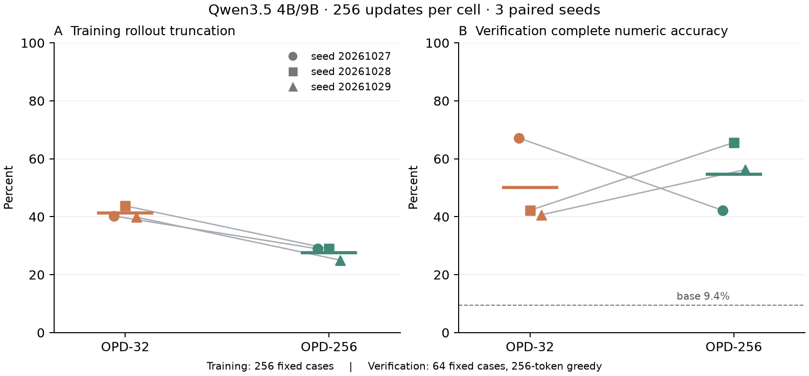
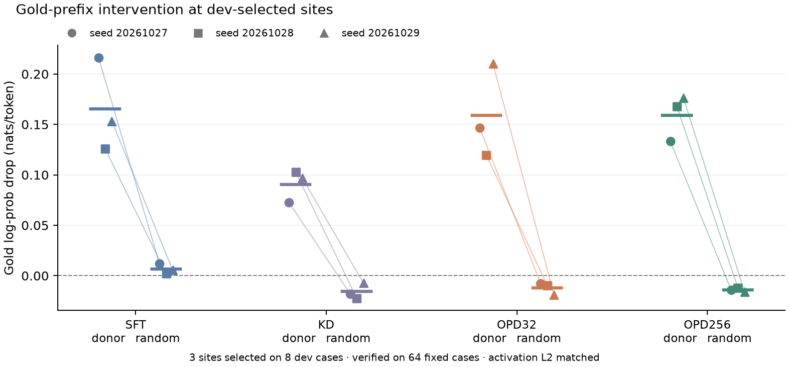

# 24-H20 配对实验结果

更长训练输出减少了截断，生成正确率的收益仍不确定。OPD训练截断率从 41.28% 降至 27.60%。在统一256-token贪心评测中，OPD-256相对OPD-32的完整数字正确率均值变化为 +4.69 个百分点；三个seed差值为 -25.00、+23.44、+15.63 个百分点。

图1：每点代表一个seed，线连接同seed的两个条件，粗横线为均值。左图使用256道训练题的采样记录；右图统一使用256-token上限、贪心生成与相同64道verification题。点在横轴轻微错位以避免重叠；横轴只表示条件。图中没有置信区间条。

## 输出预算是否带来质量收益

| Seed | OPD-32正确数／64 | OPD-256正确数／64 | 差值，百分点 | 训练截断率32→256 |
|---|---:|---:|---:|---:|
| 20261027 | 43 | 27 | -25.00 | 40.23% → 28.91% |
| 20261028 | 27 | 42 | +23.44 | 43.75% → 28.91% |
| 20261029 | 26 | 36 | +15.63 | 39.84% → 25.00% |

按三个配对 seed 计算的均值 t 区间为 [-59.91, +69.29] 个百分点（95%，df=2）。它只描述固定 64 题上的 seed 不确定性。各条件有 192 次评测，但独立 verification 题目只有 64 道；小 seed 数使该区间对分布假设敏感。

统一评测中的截断率均值为OPD-32 35.42%、OPD-256 41.15%。训练采样截断减少，与训练后贪心生成的完成率，是两个不同结果。

正确率是固定parser的数值代理：优先取最后一个`####`后数字，否则取文本中最后一个数字；主要指标还要求模型EOS结束。原始token已重新解码并复算评分，未进行人工推理内容审核。评分、格式与截断分开报告。

| 条件 | 完整数字正确率 | 数字正确率 | 格式有效率 | 评测截断率 | 平均输出token |
|---|---:|---:|---:|---:|---:|
| Base | 9.38% | 10.94% | 95.31% | 4.69% | 22.94 |
| sft | 22.40% | 22.40% | 100.00% | 0.00% | 5.51 |
| kd | 35.94% | 39.06% | 38.54% | 32.81% | 163.29 |
| opd32 | 50.00% | 55.73% | 50.52% | 35.42% | 184.65 |
| opd256 | 54.69% | 61.46% | 55.73% | 41.15% | 211.47 |

Base为同一个确定性底座评测，重复执行不增加独立样本。SFT／KD为参考条件，本轮没有为四条件两两比较预设显著性检验。

该主对照衡量 32→256 输出预算改变后的完整 OPD 配方效果。三个seed的采样／监督响应token合计为OPD-32 13,019、OPD-256 86,836。固定256步同时改变了采样路径和token量，不能据此隔离等token预算下的优化收益。

## 固定前缀上的计算干预

图2：位置只在dev前8题选择；每点是某seed在64道verification题与3个选定位置上的平均gold log-prob下降。底座donor和随机扰动的激活L2匹配。正值表示相对训练后模型降低了标准答案token概率，单位nats/token。

| Seed | 条件 | 训练 rollout 截断率 | 验证 donor−random，nats/token | dev 选出的模块 |
|---|---|---:|---:|---|
| 20261027 | sft | — | +0.204357 | layer31.ffn, layer31.attention, layer19.attention |
| 20261027 | kd | — | +0.090286 | layer17.ffn, layer20.gdn, layer28.ffn |
| 20261027 | opd32 | 40.23% | +0.154378 | layer31.ffn, layer18.gdn, layer28.ffn |
| 20261027 | opd256 | 28.91% | +0.147639 | layer31.ffn, layer28.ffn, layer17.ffn |
| 20261028 | sft | — | +0.123930 | layer31.attention, layer10.gdn, layer15.ffn |
| 20261028 | kd | — | +0.124937 | layer31.ffn, layer18.ffn, layer17.ffn |
| 20261028 | opd32 | 43.75% | +0.129213 | layer31.ffn, layer30.gdn, layer17.gdn |
| 20261028 | opd256 | 28.91% | +0.179825 | layer31.ffn, layer17.ffn, layer30.gdn |
| 20261029 | sft | — | +0.147837 | layer31.attention, layer27.attention, layer18.gdn |
| 20261029 | kd | — | +0.103896 | layer17.ffn, layer13.ffn, layer28.ffn |
| 20261029 | opd32 | 39.84% | +0.229284 | layer31.ffn, layer30.gdn, layer18.ffn |
| 20261029 | opd256 | 25.00% | +0.192359 | layer31.ffn, layer15.ffn, layer17.ffn |

十二个cell的donor−random平均差均为正，支持这些选定计算在固定标准答案前缀上的干预效果。不同seed选出的位置可以不同；同范数随机方向只控制扰动强度，没有保证两种处理的表示分布一致。

固定前缀 patching 测量的是指定内部计算对 gold token 概率的作用。底座 donor 与随机扰动在激活 L2 强度上匹配，位置只在 dev 搜索，verification 不参与选址。即使 donor 效果超过随机，也不能证明自由生成质量由相同模块介导，更不能识别训练信号的历史原因。

## 执行、恢复与成本

每 cell 完成 256 步、64 dev 和64 verification；dev 干预 1032 条、verification 干预448条；三个 Worker 各自重新运行13项 CPU门禁。复核包含16个冻结源文件、初始 adapter与样本顺序配对、checkpoint hash／有限性／游标、导出 adapter一致性、原始 token重新解码与评分，以及 dev-only top3选址。

十二组step128重放的adapter最大绝对误差为 0，loss最大绝对差为 0。干预identity最大logits绝对误差为 0。

恢复为同进程固定前缀重放。完整 logits未归档，因此 identity与重放的逐元素相对容差依赖冻结源码中的运行时断言；离线复核只能再次检查保存的最大误差和标量。恢复门禁不构成跨 Worker故障接管验证。

实际分配成本：32.822 GPU·h。成本使用所有 trial的 Pod schedule→stop区间，包含准备、诊断额外计算和归档；排队不计入。入口上限72 GPU·h不代表实际成本。

完整逐 seed指标、配对题目差值、checkpoint哈希和成本证据索引见 [analysis.json](analysis.json)。这些结果适用于 Qwen3.5-4B FP32学生、9B BF16教师与当前 LoRA／Torch后端；尚未完成更大模型、低精度后端或训练信号修复验证。
